<!--- Don't change the HTML version of this file; edit the .md version -->

* Exercise files are found [here](data/index.html)

* A video version of this tutorial is available at [https://anl.box.com/v/SequentialTutorial](https://anl.box.com/v/SequentialTutorial)

Sequential refinement is a way to fit a series of datasets collected under similar conditions with a set of closely related models. Each dataset receives an independent fit and has its own set of parameters to be fit. Thus, it is possible to track how the models evolve over the course of the measurements. One or more phases may be used to fit all all the datasets or some phases may appear in just some of the measurements, should there be phase transitions or compositional difference across the series.

Sequential refinements can be performed in three different ways:

1. Where the resulting parameters after a fit for a histogram are used as the starting point for the next histogram.

2. With differing starting parameters for each histogram

3. With the same starting parameters for each histogram

Most commonly the first mode is used initially, where the parameters for each histogram are copied as the starting point for the fit with the next dataset. After this initial refinement of all datasets is complete, the refinement is continued where the starting point for fitting to each dataset will be the parameters from the ending point of the previous fit to that histogram. 

In this example, we will fit a temperature series where both the unit cell and atomic parameters evolve with temperature. Note that it is also possible to fit a temperature series as a combined refinement and, as will be seen, one can still deal with thermal expansion (using the Hydrostatic/Elastic strain terms), but a combined refinement would allow only a single set of (averaged) atomic parameters for all temperatures. A sequential refinement allows each data set to determine the atomic parameters and allows their variation with temperature or other parametric variable(s) to be determined.

Data for this example will be downloaded with the tutorial, if you used that option to see this page. Otherwise, download file [SeqTut.zip from here](data/SeqTut.zip). This example assumes that one is already familiar with use of GSAS-II for simple refinements. Note that menu entries are listed as two strings separated by a slash such as **Help/"About GSAS-II"**, where the first string is the name of the menu (here Help) and second the name of the entry in the menu (here "About GSAS-II").

## Step I: Fit a single temperature.

While it is possible to start a sequential refinement reading in all phases and datasets from the beginning, usually it is best to know something about how the fit will be performed and this usually means performing fits to one or more representative individual datasets as the conditions or phases present change. One way to do this could be to read in all datasets but select only a single individual dataset for that fit until we are ready to fit the entire sequence. In this tutorial we will start by reading in only the first dataset and fit that. Then we will add more datasets and perform a sequential fit.

### Read phase files (CuCr2O4.cif & CuO.cif from file SeqTut.zip).

In this tutorial, to show how GSAS-II can read files directly from a ZIP archive, all of the input has been placed in a single file, named `SeqTut.zip`.  

0. If you have not done so already, start GSAS-II. 

1.  Use the  **Import/Phase/"from CIF file"** menu item to read the phase information. Select the both the `CuCr2O4.cif` and the `CuO.cif` input files. Press **OK**.

    *In the file browser dialog window that is created, on Windows change the file type from “CIF file” to “zip archive” and select the SeqTut.zip file. You may need to move to the directory where this file has been downloaded. Another dialog window will be created showing all the files in the zip archive. To simplify the view to only show the phase files, type “cif” (or “CIF” – case is ignored) into the filter.*
    
    *Note that this will create files CuCr2O4.cif and CuO.cif and, unless there are permission problems on your computer, will delete them after they are read,.* 

2. You will be asked sequentially for the name to assign to each phase. The defaults (CuCr2O4 and CuO) are fine, so **OK** can be pressed for each question.

     *Discussion: for CuCr2O4, the space group (Fddd) can be set with two origin choices. When there is a choice, GSAS-II requires the use of Origin 2, which places the origin at a center of symmetry, and this CIF has been set that way. GSAS-II confirms that from the presence of a ***-x,-y,-z*** symmetry operation, so here you are not asked to select an origin choice, but otherwise GSAS-II would note the possible ambiguity and would show the unit cell contents with each origin setting (Cu16Cr8O32 for Origin 1 rather than the correct Cu8Cr16O32 for Origin 2) and 
offer to apply a shift to the coordinates that would convert from Origin 1 to Origin 2.* ***Choice of origin is a common problem in crystallographic computations and many CIFs do not define this setting clearly, so use care with origin choices.***

### Read in file OH_00.fxye from file SeqTut.zip and map both phases to this dataset.

 
<A href="./imgs/image001.png" target="_blank" rel="noopener noreferrer">
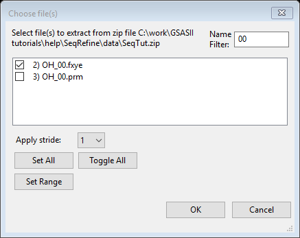
</A>

1.  Read in the ~7 K dataset (OH_00.fxye) using **Import/Powder Data/"from GSAS powder data file"** to open a file browser. Again select the `SeqTut.zip` zip archive and select file `OH_00.fxye` (use of the filter can again be helpful, as seen in the screen shot to the right) and press **OK**.
  <A href="./imgs/image002.png" target="_blank" rel="noopener noreferrer">
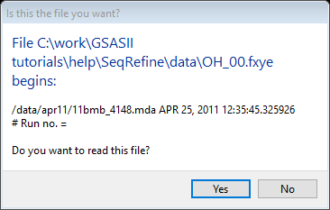</A>

2. You will be shown the first few lines from the file. Confirm that the selected file is what you want by pressing **OK**. 

    Note that the instrument parameter file with the matching name (`OH_00.prm`) is located and read automatically.

    <A href="./imgs/image003.png" target="_blank" rel="noopener noreferrer"> 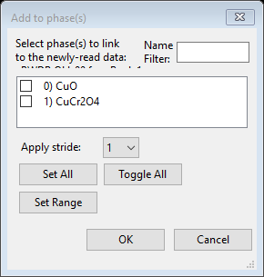</A>
    
3. Map the phases to the data: After reading in the dataset, a window used to select phases is shown, as to the right.

    Select both phases (press **"Select All"** or the checkmark buttons for each phase) and press **OK**.

     
    

### Prepare for fit: define phase fraction constraint

We want to fit the lattice parameters, background, and a phase fraction initially. While this could be avoided by only refining one phase fraction, to illustrate how constraints are used, we will refine both phase fractions, but constrain their sum to be one. Note that phase fractions are a property of both histograms and phases and are found in the Histogram/Phase section of the constraints. Knowing the variable name that GSAS-II assigns to the parameter to be constrained will make the process easier. In this case, the name assigned to a phase fraction is  `p:h:Scale` where `p` is the phase number and `h`is the histogram number. Somewhat confusingly, the name `:h:Scale` (with no phase number) is used for the histogram scale factor.

*Discussion: a single powder diffraction pattern provides enough information to determine an overall scale factor and the relative amounts of each phase (with two phases: two observables), but with the scale factor and two phase fractions being varied independently, we would have three arbitrary parameters, which is an impossible minimization problem. The GSAS-II minimizer would likely remove a degree of freedom. By defining a constraint that sets the sum of the two phase fractions, we reduce this to an appropriate two parameter problem. Attempts to refine the scale factor and all phase fractions is made often enough that GSAS-II will warn about this and will offer to define this constraint.*

0.  To move to the appropriate constraints section, click on the **Constraints** item in the data tree and then in the **Select tab** menu use the **Histogram/Phase** menu item (or click on the **Histogram/Phase** notebook tab). 

     <A href="./imgs/image062.png" target="_blank" rel="noopener noreferrer">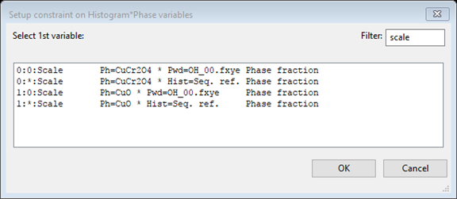</A>
 
1. To set up the constraint on the phase fraction, click on the **"Edit Constr."/"Add constraint equation"**  menu item.
This will open a dialog window. In that window set the **Filter** value to "scale" to make the list shorter and the window will appear as to the right. (If we did not know that the variable name contains scale, you could enter "phase fraction" in the filter box and also locate this name.) In the window, select the phase fraction for the first phase `0:0:Scale` (the second one, `1:0:Scale`, would work too)
 
     <A href="./imgs/image006.png" target="_blank" rel="noopener noreferrer">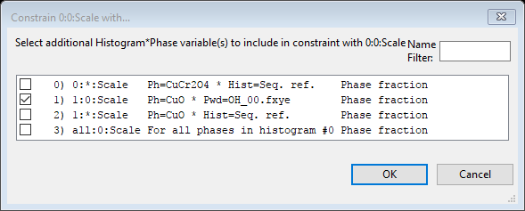</A>
    
 3. After pressing "OK" a new window appears; in that next window either select the other phase fraction (`1:0:Scale`) or select all phases (`all:0:Scale`). The same result is obtained since there is only one additional phase.

     <A href="./imgs/image063.png" target="_blank" rel="noopener noreferrer">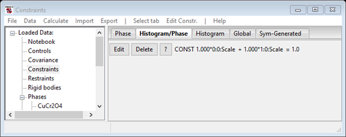</A>

 4. Press OK and this creates the desired constraint, which forces the sum of phase fractions to be 1, `0:0:Scale + 1:0:Scale = 1`, but also generates a message that there are "unused parameters in the constraint." This is because the phase fractions have not been flagged to be refined, so the constraint would be not be used. We will turn on the refinement "flags" for these parameters later, so this warning can be ignored. 
 
    *Note: while this is not needed here, if the desired constraint required multipliers for the variables or a total other than 1.0, this could be changed by pressing the button labeled "Edit" to the left of the constraint.* 
 

### Initial fit

In this step we will optimize lattice parameters & phase fractions; also the 
the background (with 6 terms) and the scale factor.
We will select the variables to refine for each phase and then the histogram parameters.

 1. 
 Select the first phase (CuCr2O4) and on the **General** tab, click on the Refine unit cell option. (If you do not see this phase listed under the Phase item in the data tree, you will need to click on the triangle to the left of the Phase entry, which “opens” the tree item).  

 
      <A href="./imgs/image064.png" target="_blank" rel="noopener noreferrer">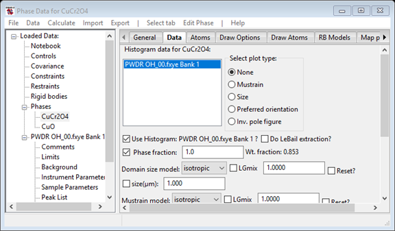</A>

2. We also want to refine the phase fraction for this phase, so select the **Data** tab and click on the Phase fraction box to cause that to be refined.

    *Note: There is a preference variable for GSAS-II (`SeparateHistPhaseTreeItem`) that moves the Histogram/Phase parameters from each phase's Data tab to a separate data tree item labeled "Hist/Phase". If you do not see a notebook tab labeled "Data" (between "General" and "Atoms"), use the "Hist/Phase" tree item for this setting.*

 2. 
Repeat this with the second phase (CuO), by selecting that phase in the data tree. Do not refine the unit cell for this phase yet, but we do want to refine the phase fraction for this phase, so select the **Data** tab and click on the Phase fraction box to cause that to be refined.

 
 3.  
To refine the background, select the **Background**  data tree entry that is a child of the  `PWDR OH_00.fxye Bank 1` histogram in the GSAS-II data tree. Confirm that Background function should already be set as chebyshev-1 and the Refine flag should be checked. Change the No. coeff. to 6 to introduce more background terms. 

 4.  
The overall histogram scale factor should already be set to be refined by default, but you may want to confirm this by clicking on the **Sample Parameters** data tree entry. 

### Reduce Data Range to 4.5 degrees

For the final step before fitting, note that the first broad peak at ~1.5 degrees $2\theta$ in these data is spurious. This artifact is known to arise from scattering from the kapton window in the cryostat used for sample cooling; this was confirmed by collecting data without a sample. We could model this peak, but it is easier to simply cut off the data below the first peak. To do this, select the `Limits` entry for `PWDR OH_00.fxye Bank 1` and change the lower limit from 0.5 to 4.5 degrees in the Tmin/New box (at the upper right).

### Perform initial fit

Use the **Calculate/Refine** main GSAS-II menu item to initiate the refinement. Since the project has not been saved, you will be asked to select a name (and optionally a directory) for the GSAS-II project (.gpx) file. The file name `SeqTut.gpx` has been used here. The refinement progresses quickly and a "Refinement Results" window is displayed with the original and fitted parameters. This shows that the Reduced $\chi^2$ value dropped in the refinement from ~3000 to ~1.8 and the Rwp (which GSAS-II labels as "Rw") is ~17%. This is an excellent improvement in the fit, which can also be judged by looking at the plot of the observed, computed and (obs-calc)/sigma [$\Delta I/\sigma (I)$] plot in the graphics window. Press **OK** on the "Refinement Results" window.

## Step II: Improve the single-temperature fit.

There are several additional variables that should now be added, now that we have reasonable starting unit cell parameters, etc. This includes adding a sample displacement parameter, improving the background treatment and some sample broadening terms for the profile. You can perform a refinement after each of the following steps or wait until Step 2.3.

### Refine the impurity lattice constants.

The CuO phase is present only at trace levels (a weight fraction of ~0.5%, a level that is probably invisible in lab data) and this phase is monoclinic, so it is best to wait until a good fit is obtained before adding these four variables to the fit, so now open the **General** tab for the **CuO data tree entry** and add a checkmark to the "Refine unit cell" entry. 

### Improve histogram fitting.

#### 2.2.A: Refine the Sample X displacement term

* Click on the Sample Parameters data tree subitem for histogram `PWDR OH_00.fxye Bank 1`. Select the refine checkbox that is labeled "Sample X disp. perp. to beam." The value for this is the displacement in microns (10-6 m), provided the diffractometer radius is entered correctly. Set the Goniometer radius to 1000.

    *Discussion: Diffractometers are never perfectly aligned, which means one should always an alignment parameter. While in older programs, the alignment parameter was a zero correction (except for Bragg-Brentano instruments), but a zero correction does not properly correct for mispositioning of the sample from the center of the goniometer arc. GSAS-II offers a geometrical correction for that being offset perpendicular to the direction of the beam as the Sample X displacement (and for where data is collected to angles above 120 degrees 2theta, it is also possible to fit a second term for Sample Y displacement for displacement along the beam direction.) When using GSAS-II, refine the Sample X displacement parameter rather than the 2theta-zero correction. (Refinement of both is not normally possible).*

    Note: With a well characterized instrument, as is the case here for 11-BM at the APS, none of the Instrument Parameters or other Sample Parameters (beyond "Histogram scale factor" and "Sample X displ.") need to be fit.

#### 2.2.B: Add a background peak.

 <A href="./imgs/zoom.jpg" target="_blank" rel="noopener noreferrer">
    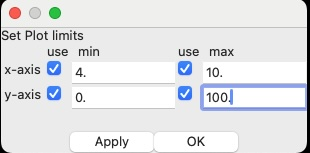
    </A>
The background has not been well-fit with 6 terms. This is only clear if you magnify the plot considerably. One quick way to do this is to select the **Background** data tree entry that is a child of the `PWDR OH_00.fxye Bank 1` histogram and the **Background/"Select plot limits..."** menu item. As shown to the right, enable all four limits with their checkboxes and enter a range of 4 to 15 degrees for the x-axis and 0 to 100 for the y-axis. The plot of the data will appear as below. This is due to polymer scattering from the kapton tube used to hold the sample. While we could try to fit this by increasing the number of background terms significantly, it requires far fewer parameters to add a broad peak to the background. 

 <A href="./imgs/zoomplot.jpg" target="_blank" rel="noopener noreferrer">
    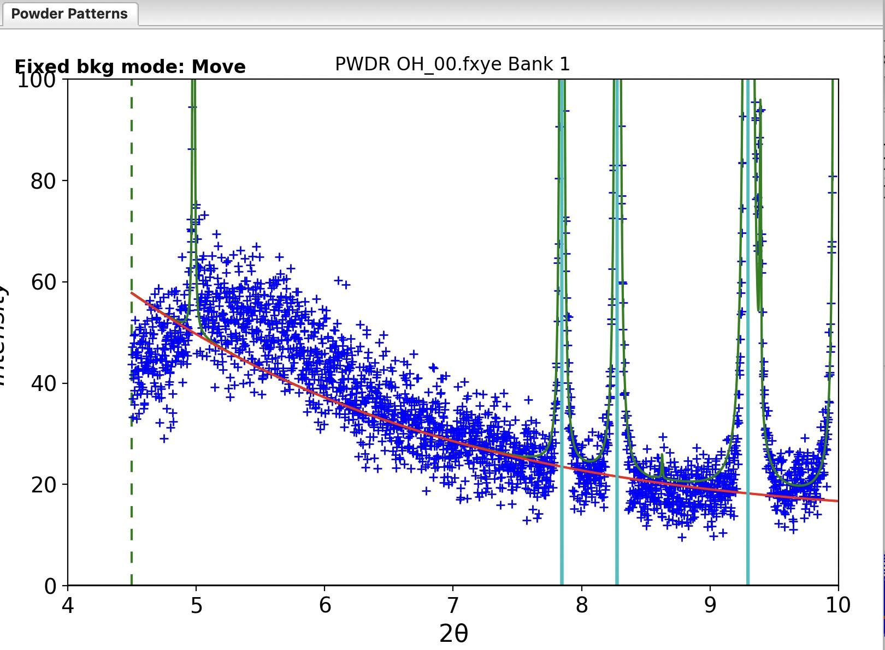
    </A>

 
    <A href="./imgs/image065.png" target="_blank" rel="noopener noreferrer">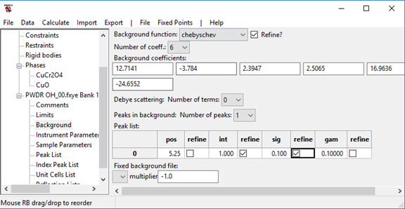</A>

   * Change the "Peaks in background value" dropdown from 0 to 1 and then change the values for that peak to pos=5.25 degrees, int=100.0 and sig=2000. Set the refinement flag for the intensity parameter (immediately to the right of the value) to refine it. 

   ***Important: note that after clicking on a checkbox, you may need to click elsewhere in the window so that this input is recorded.***

   *We will postpone refining this background peak position and width terms and since there is not very much intensity on the low-angle side of this peak and the Chebyschev polynomial terms and the background peak terms are highly correlated, so there is a chance that refining all the terms at one time might result in the peak drifting away from where it is needed. Waiting until the peak is better fit allows the refinement to proceed better.*

   *Note that as each number is changed, the background curve is updated, though you will have trouble seeing changes due to this very wide peak unless the intensity is raised to 500 or larger.* 

#### 2.2.C: Treat sample broadening.

* On the Data tab for the phase, turn on the refine flags for the crystallite size parameter and the isotropic microstrain parameters for the CuCr2O4 phase. These are the two checkmark boxes to the left side of the "size($\mu$m)" and "microstrain" labels. For the CuO impurity refine only the isotropic microstrain parameter.

    *While refinement of microstrain and crystallite size together is often problematic, unless data are fit over a wide Q range, here we are using data up to a Q value of nearly 7 Å$^{-1}$ and further the instrumental resolution of 11-BM is excellent so the sensitivity to sample broadening is quite good. For the CuO impurity, which only has a few visible peaks, refinement of more than one broadening parameter is unlikely to succeed. Use of either broadening parameter should be fine, but microstrain is more common in powder diffraction than crystallite broadening.*

### Perform an additional fit

Starting an additional refinement (using the **Calculate/Refine** menu item) with the addition of the five more variables to the refinement improves the fit significantly visually, and the reduced $\chi^2$ drops to 1.5, though the Rw value drops only to ~15.7%.

### Add still more sample parameters.

#### 2.4.A:  Vary background peak position and width

* Again select the **Background** data tree entry that is a child of the `PWDR OH_00.fxye Bank 1` histogram and add the refinement flags for pos and sig so that all three background peak values will be refined. 

#### 2.4.B: Use Uniaxial (010 axis) microstrain broadening for CuCr2O4

Close examination of the pattern shows that the peak widths are not as well fit as desired. It is not obvious from the plot, but some peaks are too wide and others too narrow, indicating that there is asymmetric peak broadening. Note also that the size value is >2 $\mu$m, which is very minor crystallite size broadening. (This would be invisible on most other instruments). The microstrain broadening, while small, is more significant, so it makes sense to try a uniaxial anisotropic microstrain model. With an orthorhombic cell, there are a number of possible preferred directions, but in this case I found that use of the two parameter uniaxial model while setting (100) as the unique axis fits almost as well as the six parameter generalized model. 

* On the Data tab for the CuCr2O4 phase, change the Mustrain model from "isotropic" to "uniaxial," change the "unique axis" to "1 0 0"  (note: leave at least one space between the numbers) and turn on the refine flags for both the equatorial and axial mustrain terms. 

#### 2.4.C: Perform an additional fit

Start an additional refinement (using the **Calculate/"Sequential refine"** menu item) with the addition of these variable parameters and the refinement improves the fit significantly visually. The $\Delta(I)/\sigma(i)$ [(obs-calc)/sigma] plot is now dominated by noise and the Reduced $\chi^2$ value is 1.1 (or lower if more than 3 refinement cycles are used). This is an excellent fit, nearly ideal, 
particularly considering that we have not refined any atomic parameters. The Rw value has not changed that much, remaining at ~13.5%, showing that this value can only be used to compare different fits to one set of data and not as a way to judge overall fit quality. This is clearly a good enough place to start a sequential refinement including all the datasets.

## Step III: Prepare for sequential fit.

There is one significant way that sequential fitting differs from the usual refinement process. Rather than fitting lattice constants directly, in sequential fits we will use the Hydrostatic/Elastic strain terms (parameters `
:<h>:Dij`, which we call the `Dij` terms) to treat the change in lattice parameters from histgram to histogram. This is because there is only one set of lattice constants for each phase, but there are  `Dij` terms for every histogram and phase. The `Dij` terms are found on the phase's "Data" tab (or on the "Hist/Phase" tree entry).

*More details: Note that while GSAS-II displays unit cell parameters in the traditional a, b, c, α, β & γ values (distances in Å, angles in degrees), internally computations are performed only after converting this cell to a version of the reciprocal lattice tensor we call the "A tensor" or the `Aj` terms ([see the GSASIIlattice documentation](https://gsas-ii.readthedocs.io/en/latest/GSASIIutil.html#gsasiilattice-unit-cells)). The actual values used computationally in GSAS-II are these `Aj` terms, which are refined as allowed by unit cell symmetry. There is one set of `Aj` values for each phase, but to treat the situation where histograms may have slightly different values for each phase's lattice parameters, GSAS-II defines `Dij` terms, labeled as "Hydrostatic/elastic strain coefficients", for each phase in each histogram, which are offsets added to the `Aj` terms. If the `Dij` terms are positive then the reciprocal cell is larger and the real-space cell is smaller. For an example showing where the lattice constants differ for a phase between two histograms [see the PbSO4 combined fitting tutorial](https://advancedphotonsource.github.io/GSAS-II-tutorials/CWCombined/Combined%20refinement.htm), where datasets were collected at different temperatures.
When the `Dij` terms are non-zero, the resulting unit cell dimensions are shown adjacent to them, applying these shifts to the unit cell values from the "General" tab.*

### Remove refinement of sensitive parameters 

For the initial fitting of datasets over a range of conditions, we will want to start from the fitted values we have fit, but until we have reasonably good values for the scale factor, background and lattice parameters, etc, we do not want to refine any thing else.
We will turn off refinement of the phase fractions, peak widths and sample displacement terms. We will also switch from fitting lattice parameters directly to fitting the  `Dij` terms.

#### 3.1.A:  Reset CuCr2O4 refinement settings

Select the first phase (CuCr2O4)
 <A href="./imgs/image067.png" target="_blank" rel="noopener noreferrer">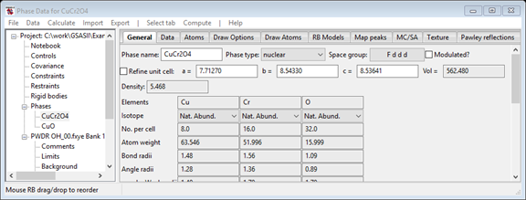</A>

* On the General tab,  turn off lattice parameter refinement by removing the checkmark from the "Refine unit cell" option by clicking on it.  
 
<A href="./imgs/image068.png" target="_blank" rel="noopener noreferrer">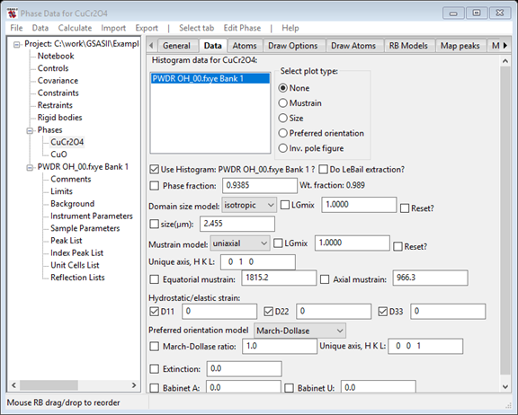</A>

* On the Data tab (for CuCr2O4), turn off all four refinement flags: for the Phase fraction, the size and both the mustrain parameters. 
* Turn on refinement of the D11, D22 and D33 terms to allow the lattice parameters to vary histogram by histogram. 

    The Data window should appear as seen to the right.

#### 3.1.B:  Reset CuO refinement settings
Select the second phase (CuO) 
 
<A href="./imgs/image069.png" target="_blank" rel="noopener noreferrer">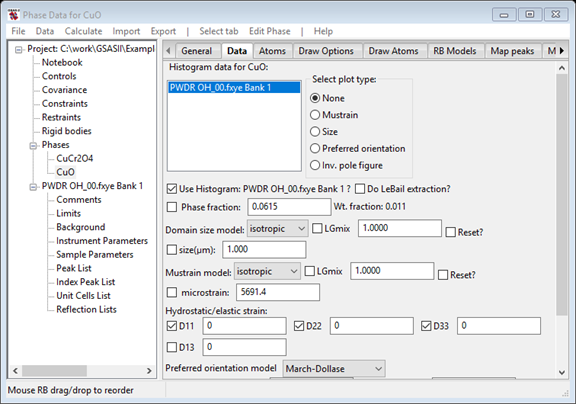</A>

* On the Data tab, turn off refinement of the Phase fraction and the microstrain parameters. 
* Turn on refinement of the D11, D22 and D33 terms to allow the combined lattice parameters to vary. We could refine the D13 term [which is related to cos(β*) angle for CuO] but the changes to this are small and since this is a minor phase and few CuO peaks are seen, it is best to not vary this, at least not initially. 

    The Data window should appear as to the right.

* On the General tab for CuO, click on the Refine unit cell option to turn off refinement of that.

#### 3.1.C:  Limit background peak refinement 

We want to minimize the chances for the background refinement to diverge significantly from the good fit we have obtained, so reducing the number of refined parameters will help. 
 
<A href="./imgs/image070.png" target="_blank" rel="noopener noreferrer">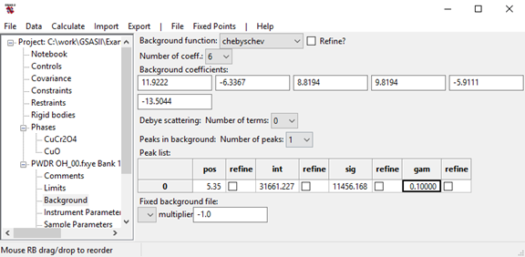</A>

 * Turn off refinement of the background peak refinement position and width (sig) terms by clicking on the Background histogram tree item and removing checks from the first and third items in the background peaks table (which has only one row). 

#### 3.1.D:  Delay fitting sample displacement
 
<A href="./imgs/image025.png" target="_blank" rel="noopener noreferrer">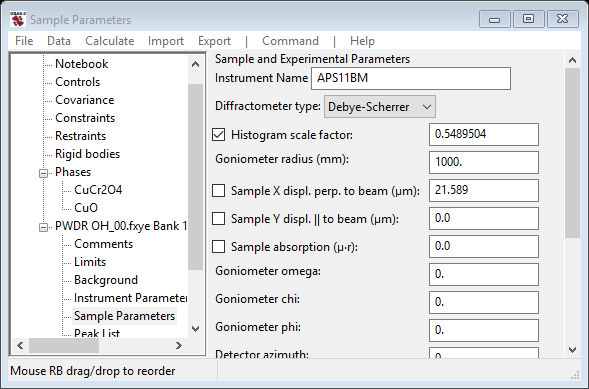</A>

* Likewise, select the histogram Sample Parameters tree entry and on that window, turn off the refinement flag for "Sample X displ..."

 

#### 3.1.E:  Optional: confirm model fit has not changed

At this point the refinement can be repeated to show that the fit has not changed significantly. If this is done, one will see small non-zero values for the `Dij` terms, but the unit cell parameters displayed on the "Data" tab (or  "Hist/Phase" tree item) are not significantly different from those computed without the `Dij` values shown on the "General" tab, but due to the larger uncertainties on the CuO unit cell parameters, the `Dij` terms are much larger than for CuCr2O4.

## Step IV: Import the remaining datasets.

In this step we bring in the remaining data. Note that the values for the parameters for the newly-read histograms (on the Sample Parameters data item) and the phase/histogram parameters on each phase's Data tab are set to default values, so we copy the values from the first histogram to the new sets. We can then perform an initial sequential fit.

### Read the remaining datasets.

 
<A href="./imgs/image026.png" target="_blank" rel="noopener noreferrer">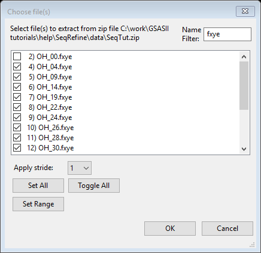</A>

* Use the Import/Powder Data/"from GSAS powder data file" to again open zip archive `SeqTut.zip` file. 
* Select all the .fxye files except `OH_00.fxye` (use of the filter can again be helpful: Enter fxye for the filter; Press Set All and then unselect `OH_00.fxye`; or select `OH_00.fxye` and press Toggle All). 
* Then press OK to start reading the datasets.

 
In the previous diffraction data import, the instrument parameter file was located automatically because it had the same name as the powder data file, but for this step, there is no matching file, so you will be presented with a list of files in the ZIP archive where you will need to pick the instrument parameter file.

* Select the same file that was used before: ``OH_00.prm` from the dialog window and press OK. 

* Set all the newly-read histograms to be connected with both the CuCr2O4 and CuO two phases, as was done before in [step I.2](#I.2.C), above.

*Note that in a sequential fit, files are processed in the order they appear in the tree (or the reverse of that order, if so set in Controls). It will be most convenient if the files are imported in parametric sequence. You may need to use multiple Import operations to read the files, or rename some files prior to reading them, so they are read in the correct order. If files have not been read in the intended order, it will be necessary to manually change the positions of the tree items. (This is done by dragging them in the tree with the right mouse button pressed). This is not an issue in this example, since the files are listed in a zip file in the order they need to be read, but may be of concern for other cases.* 

### Optional: Plot all datasets
 
<A href="./imgs/image072.png" target="_blank" rel="noopener noreferrer">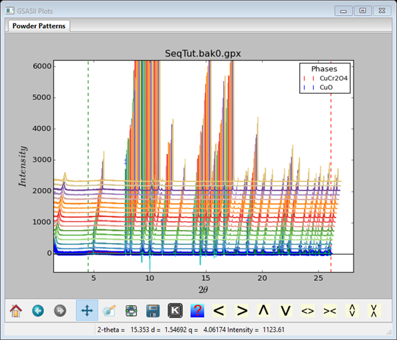</A>

After all 17 histograms have been imported, the graphics window will display only the last histogram that was read (mode is to display the last dataset read in (`PWDR OH_53.fxye Bank 1`). If you want to see the entire ensemble of data sets as a "waterfall plot," as seen to the right, click on the main data tree entry for any of the datasets (for example `PWDR OH_00.fxye Bank 1`), click on the frame of the plot window and press the “m” key. (Alternately, press the “K” icon from the list at the bottom of plot, between the “floppy disk” and “question mark” icons, and then select “m: toggle multidata plot” from the pop-up window). The ‘U’, ’D’, ’R’ & ‘L’ keys control the appearance of the waterfall plot.

 
<A href="./imgs/image073.png" target="_blank" rel="noopener noreferrer">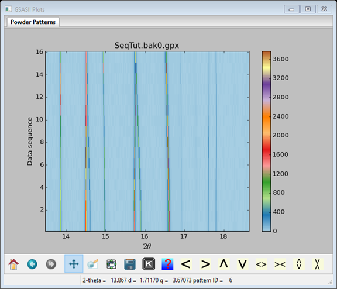</A>

To toggle between a waterfall plot and a contour plot, as seen to the right, press the ‘C’ key; use the ‘U’ and ‘D’ keys to change the contrast. I’ve used ‘D’ to increase the contrast & zoomed in on the 13-19 degree region where the effect of temperature on the peak positions can be seen

### Duplicate settings to the new histograms.

In the fit to the initial histogram, we changed several things, such as the data limits and added a background peak. Several additional parameters were refined. We will want to use those values as the starting point for the histograms that were just imported. There is an easy way to duplicate these settings: 

* Select the original `PWDR OH_00.fxye Bank 1` tree entry 
 
<A href="./imgs/image033.png" target="_blank" rel="noopener noreferrer">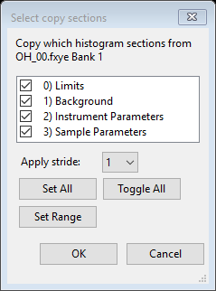</A>
* Use the menu command **Commands/"Copy params"**. This will open the window shown to the right, We need to duplicate the values in the Limits, Background and Sample Parameters sections between all histogram, so those entries should be selected. The Instrument Parameters were all read from the same instrument parameters file and have not been changed, so it does not matter if that section is selected or not. Press OK to make this change. 

 
<A href="./imgs/image034.png" target="_blank" rel="noopener noreferrer">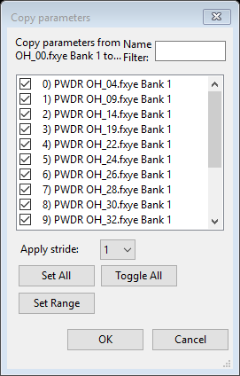</A>
The next dialog window that is displayed asks which histogram(s) should receive the parameters, as seen to the right. 

* Press Set All to select all remaining histograms and then press OK.

    *This copy step will duplicate the parameters and their refinement flags from the selected data tree entries. Note that when Sample Parameters are copied, the values that would be expected to change in a parametric fit, such as setting angles, temperature, pressure etc. are not copied.*
 

Optional: To verify that the copy has been performed, examine any of the other histogram plots (e.g. to see the changed lower limit), etc. or view the contents of the various updated sections to see that the background values and refinement flags, sample parameters, etc., have been changed. 

### Duplicate Phase/Histogram settings.

Next we need to copy the Phase/Histogram parameters, which have the phase fractions, sample broadening terms and `Dij` terms. 
 
<A href="./imgs/image035.png" target="_blank" rel="noopener noreferrer">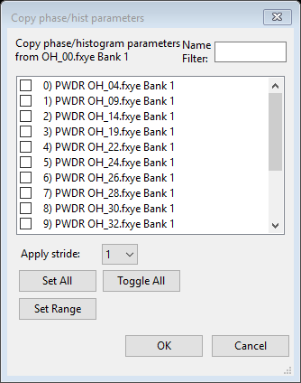</A>

* To do this, select the first phase (CuCr2O4) in the data tree and then the Data tab in the window and in the list of histograms, be sure that the first histogram, `PWDR OH_00.fxye Bank 1` is selected in the list at the upper left. 
* Then use the **"Edit Phase"/Copy data**  menu command, which raises the selection window to the right.
* Press the Set All button and then press the OK button.

 
Repeat the previous three steps to copy the Phase/Histogram parameters for the CuO phase:

* Select the second phase (CuO in the data tree and then the Data tab in the window and in the list of histograms, be sure that the first histogram, `PWDR OH_00.fxye Bank 1` is selected in the list at the upper left. 
* Use the **"Edit Phase"/Copy data**  menu command.
* Press the Set All button and then press the OK button.

## Step V: Setup and start the sequential refinement.

At this point we determine which histograms will be used in the fit and set that the resulting parameters from the results of each refinement will be used for the subsequent refinements and the run the first sequential fit. Also, we increase the maximum number of cycles to 10 so that the refinement will converge at each temperature. This makes sure that the refinements have enough cycles to fully adjust to the changes in lattice parameters before being used as the starting point for the next refinement. Note that if the refinement converges in less than 10 cycles, the refinement is ended at that point, so 10 is a maximum that is not likely to be reached.

### Set overall Controls for a sequential fit
 
<A href="./imgs/image074.png" target="_blank" rel="noopener noreferrer">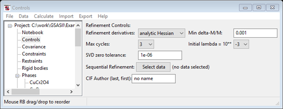</A>

* Select the Controls data tree entry. In the data window (as shown to the right) press the "Select data" button in the "Sequential Settings" session. This opens the window where all histograms can be selected. 

* Press Set All and then press OK. 

Note that the Controls window now lists the number of datasets in the sequential refinement and new controls below that. The new "Reverse order?" checkbox, would  cause the sequential refinement to start with the last histogram, not the first. Sometimes this is useful, but not here. The "Clear previous seq. results" will remove previous sequential results from a .gpx file, reducing its size.

*The **"Copy results to next histogram?"** is very useful for the initial sequential refinement. This causes the parameters obtained after fitting each histogram to be used as the starting point for the next fit. This improves the fitting considerably, as the lattice parameters change considerably as the temperature is changed from ~7 K to ~290 K. Since the temperatures changes between datasets in the series are reasonably small, each fit will start with lattice parameters that are reasonably close to the correct values, and thus fewer cycles of refinement will be needed. If the "Copy results to next histogram?" were not selected the lattice parameters from the initial 7 K fit would be used as the starting point for increasingly higher temperature datasets. At some point the initial peak positions might be too far away from the actual peak positions for the refinement to progress.* 

*The **"Copy results to next histogram?"** setting is only useful for the first refinement 

 
<A href="./imgs/image075.png" target="_blank" rel="noopener noreferrer">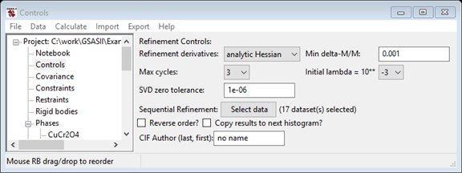</A>

*  Check the "Copy results to next histogram?" checkbox. 

 

* Also on the Controls window, change the Max cycles setting to 10. 

### Start the sequential refinement

* Start the sequential refinement with the **Calculate/Sequential refine** menu command.

    *Note that once the histograms were selected for a sequential fit in the previous step, the menu command was relabeled from **Calculate/Refine**.*

* Before the refinement is started, a window will be displayed with "Constraint Warnings." This is because the previous constraint that we established on the sum of the phase fractions  in [step 1.3](#I.3) will automatically be applied to each histogram in turn, but since we have not refined the phase fractions, the constraint processing raises warnings. Since we really do not want to vary the phase fractions yet and thus proceed despite the warning, click "Yes" to continue running the refinement.

The refinement may take a few minutes as each of the 17 datasets will be fit in turn.

### 3. Accept the sequential refinement results.

 
<A href="./imgs/image041.png" target="_blank" rel="noopener noreferrer">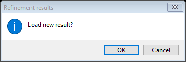</A>
When the refinement completes, a window will be displayed where you are asked if you want to load the results, as is shown to the right.

 
<A href="./imgs/image077.png" target="_blank" rel="noopener noreferrer">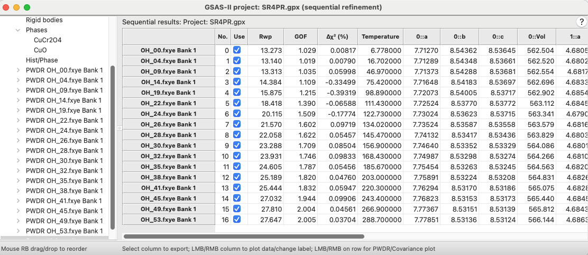</A>
After clicking on OK, the Sequential Results item is created in the data tree and is is selected, which displays a summary of the refinement results as a large table, as shown to the right.

 
The first few columns in the table show the fit quality.  The first column with a value shows the weighted profile R-factor for each fit. This shows a steady increase with temperature, as might be expected if there were a systematic change in some sample parameters, such as microstrain or background or even atomic coordinates. None of these have been been fit yet, so this is no surprise.  The small Δχ2 values (explained below) show that the fitting has largely converged, so we do not need to repeat this refinement; the next step will be to return more of the parameters that were previously refined to the fit. 
 
*The Δχ2 column, close to the Rwp column, shows the percent improvement in the χ2 value (or equivalently in the reduced χ2) in the last cycle of refinement. This is a measure of how much the refinement has converged. If in the final cycle the reduced χ2 value decreases from 4.1 to 4.0, then the value will be $100*(4.1-4.0)/4.0 = 2.5\%$; small numbers for this indicate that the changes from refinement are not improving the fit.
Larger Δχ2 values are highlighted in color.*

The next set of column(s) in this table will list any of the sample parameters that vary across the datasets. Here only the temperature changes.

The remainder of the table lists the refined parameters for each histogram and values derived from those parameters, such as the direct cell lattice constants for each phase, which are generated from the Ax and Dij terms. Scrolling the table to the right shows columns the values of most parameters that differ by histogram. 

Note that not all the refined parameters are included in this table by default. (For example, the actual Dij terms are not shown.) The choices for which items that are included is determined by the **"Hide columns..."** command in the **"Columns/Rows"** menu.

### 4. Examine the sequential refinement results.

 
<A href="./imgs/image078.png" target="_blank" rel="noopener noreferrer">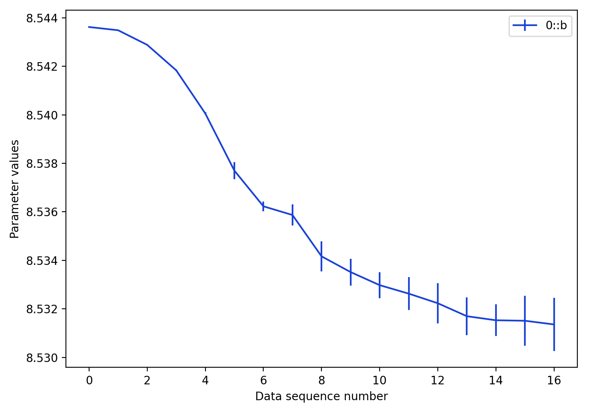</A>
Before going further, it is useful to review the trends in the lattice parameters as a sanity check. This can be done by double-clicking on a column of the table, such as the `0::b` parameter, which displays the plot to the right:

* Pressing the “s” key (or using the “K” button below the plot and selecting the "s - select x-axis" entry) brings up a menu where the x-axis can be selected. 

 
<A href="./imgs/image079.png" target="_blank" rel="noopener noreferrer">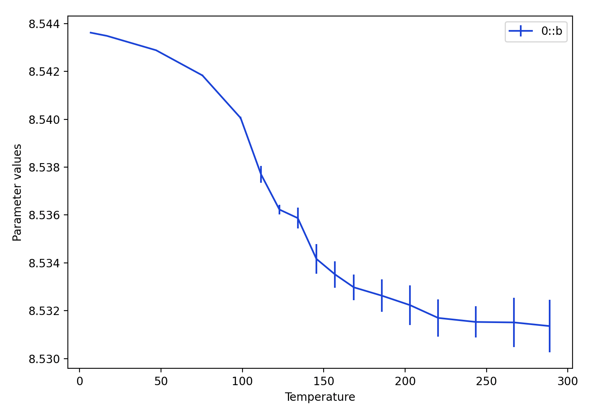</A>

* Select Temperature for the x-axis. The plot should appear as to the right, where the x-axis is now in K.

*Other things you can do here:* 

1. Left-click on a row label and the "Rietveld plot" for that histogram will be shown. 
2. Right-click on the row label and the covariance plot from that fit is shown. 
3. Also, the subsequent tutorial, ["Parametric Fitting and Pseudo Variables for Sequential Fits"](https://advancedphotonsource.github.io/GSAS-II-tutorials/SeqParametric/ParametricFitting.htm), will show how to compute values from the table or fit functions to the values. 

## Step VI: Continue the sequential refinement.

At this point we wish to continue the refinements. Note that we will want to use the results from the fit that was just completed for each histogram, rather than copying the results from one histogram to the next. After completing a sequential fit, the "Copy results to next histogram" checkbox is automatically unchecked. We want to leave this setting as unchecked. 

Since the fit for both phases is now pretty good, in the following steps we will return the previously refined parameters to the fit as well as adding additional ones. 

### Restore the parameters that were previously fit.

#### 6.1.A: Turn on refinement of the background parameters. 
* Select the Background tree entry for any histogram
* Check the refine checkmark for the position (pos) and Gaussian width (sig). There should now be 4 checkmarks: for the Chebyschev-1 terms, and for the pos, int and sig values for the background peak.
* Use the **Background/"Copy flags"** menu command to copy these refinement settings to the other histograms
* In the "Copy bkg flags" window that is opened, press "Set All" and then "OK"

#### 6.1.B: Turn on refinement of the sample displacement parameter. 

* Select the Sample Parameters tree entry for any histogram
* Check the refine checkmark for the "Sample X disp. perp. to beam." 
* Use the **Command/"Copy flags"** menu command to copy the refinement settings to the other histograms
* In the "Copy sample flags" window that is opened, press "Set All" and then "OK"

#### 6.1.C: Turn on refinement of the sample broadening and phase fraction parameters. 

* Select the CuCr2O4 phase and click on the Data tab.
* Select any histogram in the list at the upper right.
* Turn on the refinement checkmark entries for 
    1. The phase fraction 
    2. The size term
    3. The two mustrain terms (Equatorial & Axial)
* Again use the **"Edit Phase"/"Copy flags"**, "Set All" and "OK" to copy these refinement flags to all histograms.

* Select the CuO phase and click on the Data tab.
* Select any histogram in the list at the upper right.
* Turn on the refinement checkmark entries for 
    1. The phase fraction 
    2. The mustrain term
    3. The D13 "Dij" term
* Again use the **"Edit Phase"/"Copy flags"**, "Set All" and "OK" to copy these refinement flags to all histograms.

Note: Refinement of phase fractions requires the constraint that was added in [Step 1.3](#I.3). This will be automatically used for all histograms unless an option is used to specify different operation. 

### Perform the refinement.

* Start an additional refinement (using the **Calculate/"Sequential refine"** menu item). 

Note that the warning previously seen due to the unused constraints will no longer appear because now the phase fractions are being refined.

Due to refinement of the full suite of variables for fitting background, peak widths, etc., the fits improve significantly for the higher temperature datasets. Before, for the highest temperature datasets, the Rwp values were in the range of 20-30%. After this fit, all the Rwp values range from 13-17%. Note that additional columns appear now in the Sequential results table for the newly-added variables, such as the weight fractions (derived from the phase fractions). 

## Step VII: Add phase parameters to fit

The last thing we will add to the refinement will be atomic parameters. 

### Vary CuCr2O4 coordinates and Uiso Parameters.

* Select the CuCr2O4 phase and then the Atoms tab. 
 
<A href="./imgs/image059.png" target="_blank" rel="noopener noreferrer">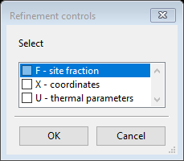</A>

* Double-click on the refine column label and a refinement controls dialog opens as seen to right, select X to refine coordinates and U to refine the atomic displacement (Uiso) values for all atoms. (Note that only the O atom has coordinates that can be refined, x, y & z for Cu and Cr are fixed by symmetry; use of the X flag for Cu and Cr will not cause those coordinates to change.) Do not refine F (site occupancies). Since these parameters and flags are shared in all histograms, no **Copy** or **Copy flags** menu item is needed (or even is available) for atomic parameters.

     
<A href="./imgs/image085.png" target="_blank" rel="noopener noreferrer">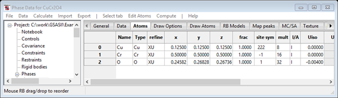</A>

     Note the X & U parameters flags now appear in the refine column of the atoms table, as to the right. 

*Phase parameters are stored a bit differently than the histogram and phase/histogram parameters that we have refined so far. There is only one set of coordinates for each phase and these will be refined for each histogram. The resulting phase parameters for each phase are saved only in the Sequential Results table. The values can be exported from the ***"Seq Exports"*** menu associated with the Sequential Results data tree entry using the ***"Seq Exports"/"Project as..."*** or the ***"Seq Exports"/"Phase as..."*** menu commands. Likewise,  the ***"Columns/Rows"/"Update Phase from selected"*** menu command causes the phase information to be updated with the selected row. If no row was selected, a dialog window with the list of histograms is displayed to make that choice.* 

### Perform final sequential fit

* Start the final refinement (using the **Calculate/"Sequential refine"** menu item). 

    Small but significant improvements are seen for fits with the higher temperature datasets, with Rwp values between 12.6% and 16.6%.

## Summary

This completes the sequential refinement tutorial, although a few more things could be attempted to try to further improve the refinement quality. Be sure to keep the final project file, since this will need for the ["Parametric Fitting and Pseudo Variables for Sequential Fits"](https://advancedphotonsource.github.io/GSAS-II-tutorials/SeqParametric/ParametricFitting.htm) tutorial, where functions of fitted parameters are computed and plotted and these results are fitted to equations of state.
